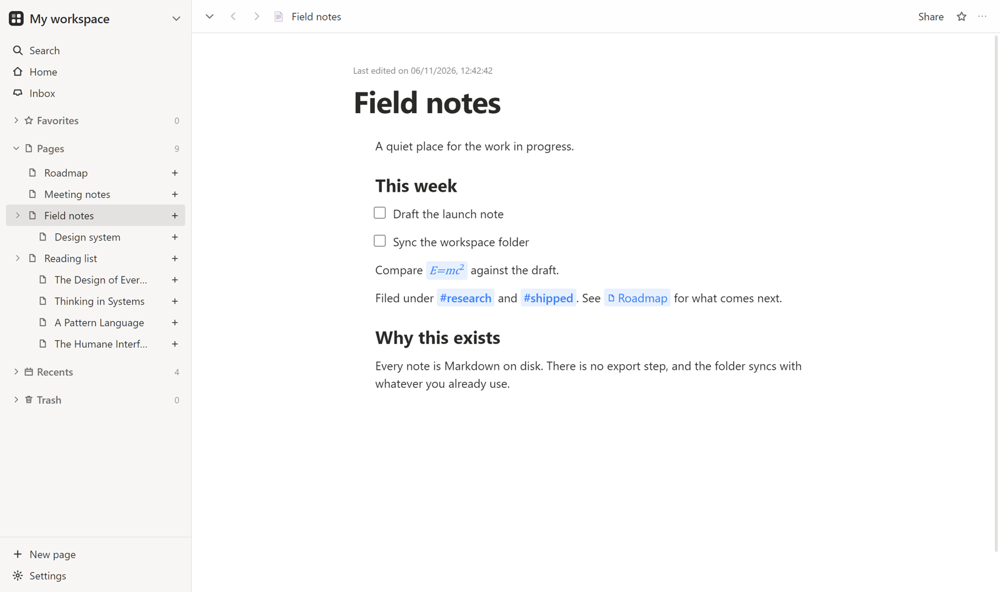
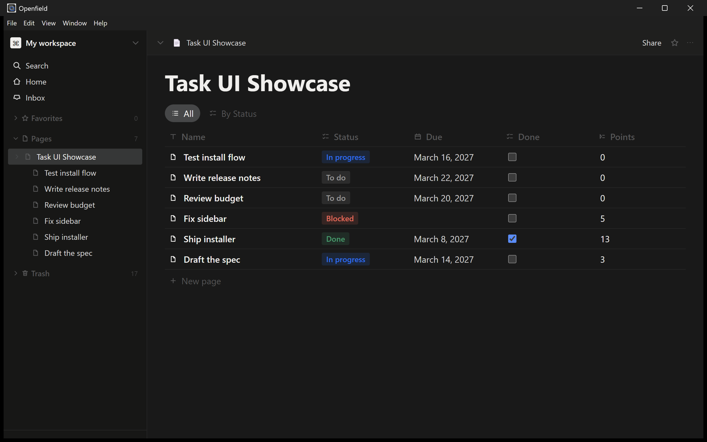
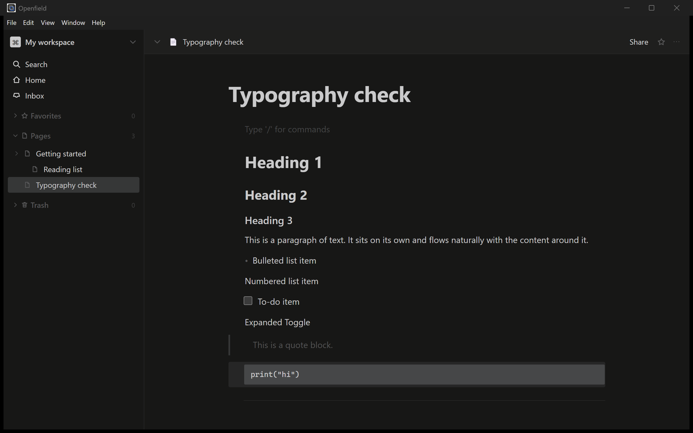

# Openfield

**A workspace that lives on your computer, not on someone else's server.**
Nested pages, a block editor and page-backed databases — no account, no sync
service, no network request at runtime.

<p align="center">
  <a href="https://github.com/Redcool47/openfield-app/actions/workflows/ci.yml"></a>
  <a href="LICENSE"></a>
  
</p>

<p align="center">
  
</p>

Openfield is a desktop application for notes that grow into a workspace. A page
can hold text, and a page can hold a database; both live in a folder you own and
open without an internet connection.

> **Openfield is not finished.** It is an early alpha: it does the everyday
> things well — pages, the editor, databases, search, import and export — and it
> is missing features a daily user will eventually want (no installer yet, no
> workspace switcher, no version history, no in-page find). The
> [gap list](docs/gaps.md) names what is missing, openly. Try it on notes you
> can afford to lose, and expect the shape of things to change before 1.0.

It is built from scratch — MIT licensed, clean-room, no vendor code or assets.
The interesting part is not the feature list but how it is put together: one
command registry drives the menus, the keyboard, the command palette, the CLI
and the test suite, so the product can be driven and checked by a script instead
of by eye.

## Get it running

There is no installer yet — packaging is wired up but the installer is
unfinished, so the app runs from source. You need Node 22.5 or newer.

```bash
git clone https://github.com/Redcool47/openfield-app.git
cd Openfield
npm install --ignore-scripts      # no native build step
npm run dev                       # builds and launches the desktop app
```

`npm install` needs no compiler: the built-in SQLite driver is preferred and
`better-sqlite3` is only a fallback.

The same engine has a command-line interface, which is handy for scripting a
workspace or looking at what the app just did:

```bash
npm run ow -- init ./my-notes
npm run ow -- run -w ./my-notes --cmd page.create
npm run ow -- pages -w ./my-notes
npm run ow -- inspect -w ./my-notes
npm run ow -- list-commands
```

A command that takes arguments takes a JSON object after its id, for example
`block.insert{"type":"heading1","text":"Reading list"}`. Quote it for your shell.

## What it does

<table>
<tr>
<td width="50%"></td>
<td width="50%"></td>
</tr>
<tr>
<td>Pages can be databases: typed properties, filters, sorts and groups, in four views.</td>
<td>A block editor with headings, lists, quotes, code, equations and callouts.</td>
</tr>
</table>

- **Pages** — nested to any depth, with breadcrumbs, back and forward that
  restore scroll, drag to reorder or nest, recents, favorites and trash.
- **A block editor** — slash menu, `@` mentions, inline marks including colour,
  a floating selection toolbar, rubber-band selection, block drag-and-drop,
  tables, to-do lists, quotes, callouts, code and equations.
- **Page-backed databases** — table, board, list and gallery views; per-type
  property operations; the same values whether you edit them in the table or on
  the row's own page.
- **Search and quick find** — SQLite FTS5 with prefix matching, `bm25` ranking
  and the ordering people expect: exact title, title prefix, title substring,
  then body.
- **Import and export** — Markdown round-trips with what Openfield exports; CSV
  becomes a typed database with whole-column type inference.
- **Undo that matches intent** — one action is one transaction. Consecutive
  typing coalesces; structural changes never do. A transaction that would leave
  the document invalid is refused.
- **An op log and an integrity check** — every mutation is appended only after
  the write it describes has committed; startup repairs orphaned blocks and
  stale search rows rather than refusing to open your workspace.

## Status

A working alpha, not a mock-up. The honest version lives in
[`STATUS.md`](STATUS.md) and [`docs/gaps.md`](docs/gaps.md).

| | |
|---|---|
| Desktop app | working: block editor, page tree, databases, search, import/export |
| Weighted feature parity | 88.8% of 172 catalogued features |
| Unit and scenario tests | 348 passing |
| End-to-end tests | 89 passing, driving the real Electron build |
| CI | 5 enforced gates on every push |
| Version | 0.2.0 |

Known gaps, so nobody is surprised later: no installer, no workspace switcher,
no version history with diff, no in-page find, no MCP server yet. The
[gap list](docs/gaps.md) names each one and what it would take.

## Development

```bash
node tools/xtask/ci.mjs        # layering, attribution, typecheck, unit, parity
npx vitest run                 # unit and scenario tests only
npx playwright test            # end-to-end, driving the desktop build
node tools/xtask/parity-report.mjs   # regenerate the coverage reports
```

`ci.mjs` stops at the first failure and prints which guarantee broke. Two more
gates — packaging and end-to-end — need a built Electron app and a display, so
they run on a developer machine rather than in CI; the workflow says so instead
of pretending they passed.

## Architecture

```
packages/
  geom/        L0  ids, fractional ordering, small pure helpers
  model/       L1  block schema, tree, transactions, undo, selection
  text/        L1  shared text helpers
  db-engine/   L1  the row engine behind databases
  formula/     L1  formula parsing and evaluation
  storage/     L2  SQLite, migrations, FTS5, integrity checks
  formats/     L2  Markdown and CSV interchange
  commands/    L3  the command registry and the session
  automation/  L4  scripted runs over the registry
  ui-kit/      L5  design tokens, primitives
  editor-ui/   L5  the editor surface
  app-ui/      L6  shared app chrome
apps/
  cli/         L7  the `ow` agent interface
  desktop/     L7  the Electron application
tools/
  xtask/           layering, attribution, parity, CI
```

A package may import only from lower layers, and a relative import may not escape
its own package; `tools/xtask/layering.mjs` enforces both and is part of CI.

The document model is a plain data structure with no UI dependency, which is why
the same editor can be driven headlessly by the CLI and the tests. The UI calls
commands; nothing else writes to the model.

## Documentation

| Document | What it answers |
|---|---|
| [`CONTRIBUTING.md`](CONTRIBUTING.md) | How to build, test and contribute without breaking the clean-room rules |
| [`STATUS.md`](STATUS.md) | Where the work stands, and what comes next |
| [`CHANGELOG.md`](CHANGELOG.md) | What changed, per version |
| [`DECISIONS.md`](DECISIONS.md) | Decisions taken, why, and when to revisit |
| [`docs/CHARTER.md`](docs/CHARTER.md) | Mission, legal rules, fidelity contract, definition of done |
| [`docs/gaps.md`](docs/gaps.md) | What is missing, unproven or assumed |
| [`docs/parity-report.md`](docs/parity-report.md) | Generated coverage numbers |
| [`SECURITY.md`](SECURITY.md) | What counts as a vulnerability here, and how to report one |
| [`ATTRIBUTION.md`](ATTRIBUTION.md) · [`THIRD_PARTY_NOTICES.md`](THIRD_PARTY_NOTICES.md) | Every bundled asset, every dependency and its licence |

## Licence

MIT — see [`LICENSE`](LICENSE) and [`NOTICE`](NOTICE).

**Independent project.** Not affiliated with, sponsored by or endorsed by Notion
Labs, Inc. or any other vendor. Product names are mentioned only to describe
workflows and file formats. No vendor source code, assets or trademarks are
included or used.
